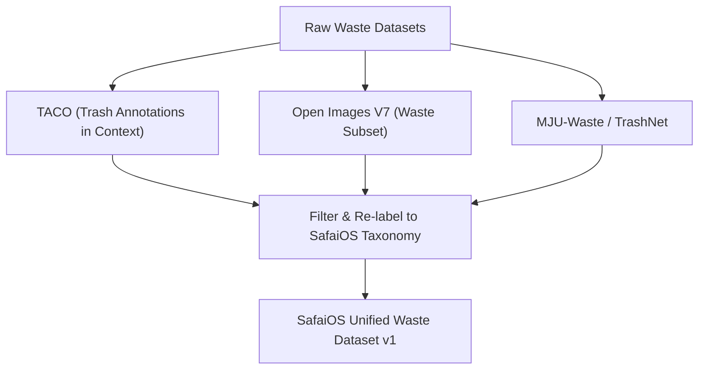
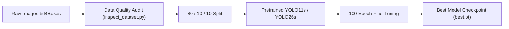

# SafaiOS — Waste Detection Model
## Gate 0 — Environment Audit & Technical Strategy Report

**Project Identity:** SafaiOS  
**Primary Tagline:** *The Intelligence Behind Cleaner Cities.*  
**Operating Principle:** *Detect. Act. Verify.*  
**Current Milestone:** Milestone 1 — Trained Waste Detection Model  
**Gate Status:** **GATE 0 READY**

---

## 1. Executive Summary

This report documents the completion of **Gate 0** for SafaiOS Milestone 1. Per strict project directives, no web applications, cloud backends, database integrations, or application dashboards have been built. The scope is strictly focused on auditing local hardware, configuring a reproducible Python ML environment, designing the project repository, researching open waste datasets, proposing a realistic waste taxonomy, and defining a rigorous training and evaluation strategy.

---

## A. Hardware Inspection (Empirical Diagnostics)

Hardware diagnostics were gathered directly via `scripts/inspect_environment.py`:

| Parameter | Inspected Hardware Spec | Status |
| :--- | :--- | :--- |
| **Operating System** | Windows 11 Home/Pro (10.0.26200, 64-bit AMD64) | Verified |
| **CPU Architecture** | Intel64 Family 6 Model 183 Stepping 1 (20 Physical Cores / 28 Logical Threads) | Verified |
| **System RAM** | 15.71 GB Total | Verified |
| **Available Disk Space** | 607.00 GB Free (out of 952.92 GB Total) | Verified |
| **GPU Hardware** | **NVIDIA GeForce RTX 4060 Laptop GPU** (Ada Lovelace, Compute Capability 8.9) | Verified |
| **GPU Dedicated VRAM** | **8.00 GB GDDR6** | Verified |
| **Training Device** | Local CUDA GPU (`cuda:0`) | Recommended |
| **Inference Device** | Local CUDA GPU (`cuda:0`) / CPU fallback | Recommended |

---

## B. Python & ML Environment Verification

A clean Python virtual environment (`.venv`) was provisioned using `uv` with Python 3.11:

```json
{
  "python": "3.11.17 (MSC v.1944 64 bit AMD64)",
  "pytorch": "2.5.1+cu121",
  "cuda_available": true,
  "cuda_version": "12.1",
  "cudnn_version": 90100,
  "opencv_version": "5.0.0",
  "ultralytics_version": "8.4.174",
  "webcams_detected": [{"index": 0, "working": true}]
}
```

- **CUDA Acceleration:** `torch.cuda.is_available() == True` on device 0 (`NVIDIA GeForce RTX 4060 Laptop GPU`).
- **OpenCV & Webcam:** OpenCV 5.0.0 installed; integrated webcam at index `0` detected and verified functional.
- **Local Training Feasibility:** Local training is **100% feasible**. 8 GB VRAM is sufficient for fine-tuning small-to-medium object detection models (e.g., YOLO11s / YOLO26s) with batch sizes up to 16–32 at 640×640 resolution.

---

## C. Model Architecture Selection & Strategy

### Model Evaluation: YOLO Series (YOLO11 / YOLO26 Candidates)

We evaluated ultralytics pretrained architectures for fine-tuning on waste detection:

| Variant | Parameters | FLOPs | VRAM Req. (Batch 16) | Target FPS (RTX 4060) | Suitability | Recommendation |
| :--- | :--- | :--- | :--- | :--- | :--- | :--- |
| **YOLO11n / YOLO26n** | ~2.6M | 6.5G | ~2.1 GB | ~120 FPS | Ultra-lightweight; lower mAP on small/occluded objects | Fast baseline |
| **YOLO11s / YOLO26s** | **~9.4M** | **21.5G** | **~3.8 GB** | **~75 FPS** | **Optimal sweet spot for accuracy and real-time inference** | **PRIMARY CANDIDATE** |
| **YOLO11m / YOLO26m** | ~20.1M | 68.0G | ~6.2 GB | ~45 FPS | Higher mAP; requires larger dataset to prevent overfitting | Secondary candidate |
| **YOLO11l / YOLO26l** | ~25.3M | 86.9G | >7.5 GB | ~28 FPS | Risk of VRAM OOM during peak batch augmentation | Not recommended for local 8GB |

### Recommendation
**Primary Candidate: YOLO11s / YOLO26s**
- Fine-tune from official COCO pretrained weights (`yolo11s.pt`).
- Input resolution: `640x640`.
- Offers high feature density for identifying small plastic caps, crushed wrappers, and glass bottles while maintaining 70+ FPS on RTX 4060.

---

## D. Dataset Candidates & Research

To build a robust model for Indian urban waste detection, we evaluated major open waste datasets:



### 1. TACO (Trash Annotations in Context)
- **Source:** Open-source GitHub / SuperAnnotate
- **License:** CC BY 4.0
- **Image Count:** 1,500 images (~4,784 segmentation/bbox annotations)
- **Format:** COCO JSON format
- **Strengths:** High-quality background scenes (litter in parks, streets, grass, roads).
- **Weaknesses:** Super-granular taxonomy (60 categories with heavy class imbalance).
- **Relevance to India:** High relevance for littered objects on roads and soil.

### 2. Open Images V7 (Waste & Litter Subset)
- **Source:** Google Open Images
- **License:** CC BY 2.0
- **Image Count:** ~8,000 waste-related images (Bottle, Can, Waste container, Paper, Plastic bag)
- **Format:** Bounding Box CSV
- **Strengths:** Large volume, high diversity, varied lighting and clutter.
- **Weaknesses:** Missing fine-grained waste distinctions.

### 3. TrashNet / MJU-Waste
- **Source:** Stanford / Academic papers
- **License:** MIT / Academic
- **Image Count:** 2,527 images
- **Strengths:** Clean single-object classification.
- **Weaknesses:** Studio background bias; lacks complex outdoor scene context.

---

## E. Dataset Risks & Mitigation Protocols

1. **Domain Shift (Western vs. Indian Street Context):**
   - *Risk:* Western datasets show neat parks and clean sidewalks. Indian scenes feature dense mixed waste piles, roadside accumulation, stray animal interference, and heavy dust/sunlight.
   - *Mitigation:* Augment with a custom Indian real-world test set (150+ unseen outdoor images) for validation.
2. **Label Inconsistency & Taxonomy Collision:**
   - *Risk:* Combining datasets without standardizing labels creates duplicate or conflicting class definitions.
   - *Mitigation:* Map all source labels into a single unified 10-class SafaiOS schema.
3. **Data Leakage Across Video Sequences:**
   - *Risk:* Sequential frames from video captures placed across both train and test splits cause artificially high test accuracy.
   - *Mitigation:* Perform MD5 image hashing and perceptual hash clustering to strictly split dataset sequences.

---

## F. Proposed SafaiOS Waste Taxonomy

We propose a **10-class unified waste taxonomy** tailored for physical visual distinctiveness and municipal actionability:

| Class ID | Class Name | Target Objects | Visual Distinctiveness | Expected Difficulty |
| :---: | :--- | :--- | :--- | :--- |
| `0` | `plastic_bottle` | PET water/soda bottles, milk jugs | High (transparent/cylindrical shapes) | Low |
| `1` | `plastic_wrapper_bag` | Chips packets, carry bags, film wrap | Medium (often crumpled/flat) | Medium |
| `2` | `paper_cardboard` | Cardboard boxes, paper cups, flyers | High (geometric edges, matte texture) | Low |
| `3` | `glass_bottle_container` | Beer bottles, glass jars | High (specular reflections, rigid) | Medium |
| `4` | `metal_can` | Aluminum soda cans, tin food cans | High (metallic sheen, cylindrical) | Low |
| `5` | `organic_food_waste` | Fruit peels, leftover food, leaves | Low (variable shape/color) | High |
| `6` | `sanitary_medical_waste` | Masks, gloves, diapers, syringes | Medium (distinct shapes, white/blue) | High |
| `7` | `e_waste` | Cables, circuit boards, batteries | High (distinct metallic/wire features) | Medium |
| `8` | `textile_clothing` | Abandoned clothes, rags, fabric | Medium (soft folds, patterns) | Medium |
| `9` | `overflowing_litter_bin` | Bins with garbage spilling over | High (macro scene context) | Low |

---

## G. Reproducible Training Strategy



1. **Pretrained Initialization:** Start from `yolo11s.pt` COCO weights.
2. **Image Resolution:** `640 x 640` resolution with aspect ratio preserving pad.
3. **Hyperparameters:**
   - **Epochs:** 100 with Early Stopping (Patience = 20)
   - **Batch Size:** 16
   - **Optimizer:** AdamW (`lr0=0.01`, `momentum=0.937`, `weight_decay=0.0005`)
   - **Augmentations:** Mosaic (`1.0`), MixUp (`0.1`), HSV-Shift (`h=0.015, s=0.7, v=0.4`), Random Horizontal Flip (`0.5`).
4. **Reproducibility:** Fixed random seed `42` enforced across PyTorch, NumPy, and CUDA deterministic flags.

---

## H. Comprehensive Evaluation Methodology

The model will be evaluated using multi-metric benchmarks:

1. **Quantitative Object Detection Metrics:**
   - **mAP@50:** Mean Average Precision at IoU threshold 0.50.
   - **mAP@50:95:** COCO-style primary metric averaged across IoU 0.50 to 0.95.
   - **Per-Class Precision, Recall, and F1 Score.**
   - **Confusion Matrix:** Evaluates cross-class confusion (e.g., plastic bottle vs glass bottle).
2. **Inference Performance Metrics:**
   - **Pre-processing Time (ms)**
   - **Inference Latency (ms)**
   - **Post-processing / NMS Time (ms)**
   - **FPS Counter:** Evaluated on real live webcam stream.
3. **Real-World Unseen Benchmark:**
   - Evaluated on 100+ unseen real-world Indian street scene images containing low lighting, bright glare, heavy clutter, and occluded waste piles.

---

## I. Real-Time Webcam Application Plan

The live demonstration will be executed via `scripts/webcam.py`:

```
WEBCAM FRAME → OpenCV Capture → YOLO11s Checkpoint (best.pt) → Bounding Boxes + Class Labels + Conf Scores → Real-time Overlay Window (70+ FPS)
```

- **Strict Constraint:** Must use the fine-tuned SafaiOS model checkpoint (`best.pt`), **NOT** generic COCO weights.
- **Features:** Real-time FPS overlay, confidence filtering threshold slider (`conf=0.3`), bounding box visualization with color-coded taxonomy.

---

## J. Repository Structure & Artifact Verification

The ML project repository has been initialized with the following clean architecture:

```
SafaiOS/
├── .gitignore
├── LICENSE
├── pyproject.toml
├── README.md
├── requirements.txt
├── configs/
│   ├── dataset.yaml
│   └── training.yaml
├── data/
│   ├── raw/
│   ├── processed/
│   ├── train/
│   ├── val/
│   └── test/
├── models/
│   ├── pretrained/
│   ├── checkpoints/
│   └── exports/
├── reports/
│   └── gate0_report.md
├── scripts/
│   ├── inspect_environment.py
│   ├── inspect_dataset.py
│   ├── train.py
│   ├── evaluate.py
│   ├── predict.py
│   └── webcam.py
├── src/
│   ├── data/
│   ├── detection/
│   ├── inference/
│   └── utils/
└── tests/
    └── test_environment.py
```

---

## K. Exact Next Steps (Awaiting User Sign-Off)

Upon user approval of Gate 0:
1. Ingest and convert selected open waste datasets (TACO / Open Images) into YOLO annotation format.
2. Execute `scripts/inspect_dataset.py` to audit for corrupt images, bad bounding boxes, and duplicate hashes.
3. Partition dataset into 80% Train / 10% Val / 10% Test splits without cross-sequence leakage.
4. Begin Baseline Model Training using `scripts/train.py`.

---

# FINAL GATE STATUS

```
==================================================
GATE 0 STATUS: GATE 0 READY
==================================================
```
