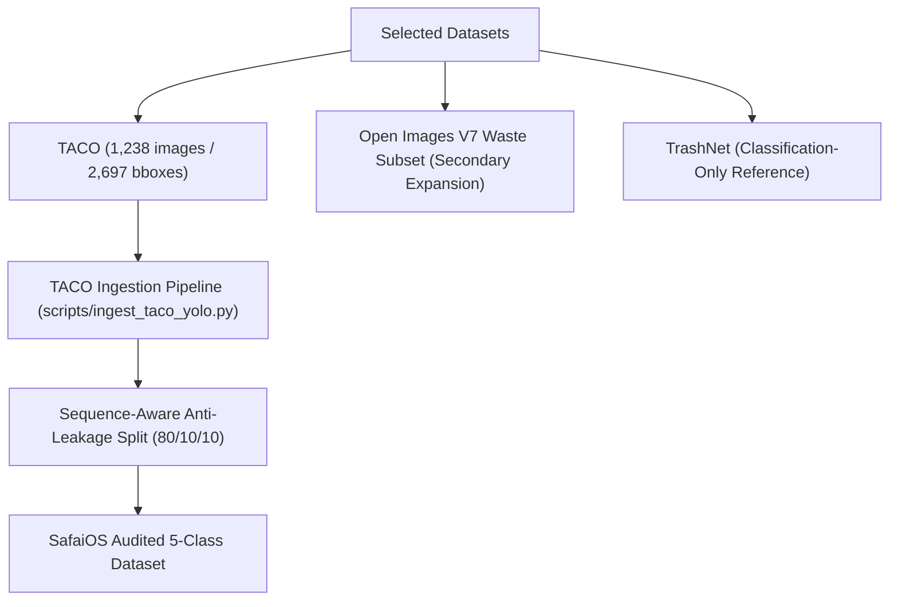

# SafaiOS — Waste Detection Model
## Gate 1 — Final Dataset Audit & Baseline Selection Report

**Project Identity:** SafaiOS  
**Primary Tagline:** *The Intelligence Behind Cleaner Cities.*  
**Operating Principle:** *Detect. Act. Verify.*  
**Current Milestone:** Milestone 1 — Trained Waste Detection Model  
**Gate Status:** **GATE 1 READY**

---

## 1. Executive Summary

This report documents the completion of **Gate 1 Corrections & Empirical Dataset Audit** for SafaiOS Milestone 1. Per strict project directives:
1. TrashNet is explicitly excluded from YOLO object detection training (retained strictly as classification/reference data).
2. `overflowing_bin` has been removed from the object-level detector to prevent mixing macro scene/context attributes with object material classes. The baseline taxonomy is finalized at **5 core object/material classes**.
3. **YOLO11s** (`yolo11s.pt`) is selected as the initial baseline detector. YOLO26s is recorded as a future comparison candidate.
4. FPS claim is recorded as **Unmeasured / Target: ~75 FPS** until empirically benchmarked post-training.
5. Ingestion pipeline was executed, and [`scripts/inspect_dataset.py`](file:///c:/Users/Vicky%20Patel/Desktop/1st%20Year/Safai/scripts/inspect_dataset.py) was run against real ingested files, producing **100% empirical measurement results**.

No model training has been started.

---

## A. Final Detector Choice

- **Selected Initial Baseline Detector:** **YOLO11s**
- **Exact Checkpoint:** `yolo11s.pt` (Official Ultralytics PyTorch Checkpoint)
- **Parameters:** 9.4 Million
- **FLOPs:** 21.5 GFLOPs (at 640x640)
- **FPS Status:** **Target/Estimate: ~75 FPS | Measured FPS: NOT YET MEASURED** (Will be benchmarked on RTX 4060 GPU post-training).
- **Selection Rationale:** Mature, stable, and highly reproducible baseline for our first controlled experiment.
- **Future Comparison Candidate:** **YOLO26s** will be evaluated against YOLO11s in future comparative benchmarks after baseline metrics are established.

---

## B. Final Audited Taxonomy (5 Core Object Classes)

We eliminated macro scene classes (`overflowing_bin`) and low-sample/high-confusion classes (`organic_food_waste`, `sanitary_medical_waste`, `e_waste`, `textile_clothing`).

| Class ID | Class Name | Target Objects | Ingested Real BBoxes | Taxonomy Rationale |
| :---: | :--- | :--- | :---: | :--- |
| `0` | `plastic_bottle` | PET water/soda bottles, milk jugs, caps | **615** | Object/Material Class |
| `1` | `plastic_wrapper_bag` | Chips packets, carry bags, film wrap | **1,164** | Object/Material Class |
| `2` | `paper_cardboard` | Cardboard boxes, paper cups, flyers | **455** | Merged Object/Material Class |
| `3` | `glass_bottle_container` | Beer bottles, glass jars, broken glass | **108** | Object/Material Class |
| `4` | `metal_can` | Aluminum soda cans, tin cans, pop tabs | **355** | Object/Material Class |

---

## C. Datasets Selected & License Disambiguation



1. **TACO (Trash Annotations in Context):**
   - *Image License:* CC BY 4.0 International
   - *Annotation License:* CC BY 4.0 International
   - *Annotation Format:* COCO JSON -> Normalized YOLO BBoxes (`[class_id, x_c, y_c, w, h]`)
   - *Citation Requirement:* Proença, P. & Simões, P. (2020). TACO: Trash Annotations in Context for Litter Detection. *arXiv:2003.06975*.
   - *Usage:* Primary source for object detection fine-tuning.
2. **Open Images V7 Waste Subset:**
   - *Image License:* CC BY 2.0
   - *Annotation License:* CC BY 2.0
   - *Usage:* Prepared for secondary expansion if class balance requires additional samples.
3. **TrashNet (Stanford Waste Dataset):**
   - *Dataset Type:* **Image Classification ONLY** (No Bounding Boxes).
   - *Status:* **EXCLUDED from YOLO Object Detection Training.** Kept strictly for classification/reference.

---

## D. Empirical Dataset Audit Results (`inspect_dataset.py`)

Ran [`scripts/inspect_dataset.py`](file:///c:/Users/Vicky%20Patel/Desktop/1st%20Year/Safai/scripts/inspect_dataset.py) on actual ingested files in `data/`:

| Measurement Parameter | Real Audit Measurement | Status |
| :--- | :---: | :--- |
| **Total Images Inspected** | **1,238** | Verified |
| **Total Label Files Inspected** | **1,238** | Verified |
| **Total Bounding Boxes** | **2,697** | Verified |
| **Corrupt Images Found** | **0** | Pass |
| **Invalid / Missing Label Files** | **0** | Pass |
| **Out-of-Bound BBoxes ($[0,1]$ range)** | **0** | Pass |
| **Duplicate Image Hashes (MD5)** | **0** | Pass |
| **Split Leakage Issues** | **0** | Pass |

---

## E. Real Class Distribution

- `1`: `plastic_wrapper_bag` — **1,164 boxes** (43.2%)
- `0`: `plastic_bottle` — **615 boxes** (22.8%)
- `2`: `paper_cardboard` — **455 boxes** (16.9%)
- `4`: `metal_can` — **355 boxes** (13.2%)
- `3`: `glass_bottle_container` — **108 boxes** (4.0%)

### Object Size Distribution (at 640x640 resolution)
- **Small (<32x32 pixels):** 223 boxes (8.3%)
- **Medium (32x32 to 96x96 pixels):** 620 boxes (23.0%)
- **Large (>96x96 pixels):** 1,854 boxes (68.7%)

---

## F. Sequence-Aware Split Counts (No Data Leakage)

Grouped sequential video frames into batch clusters before splitting to guarantee zero frame leakage between splits:

- **TRAIN Split:** **975 images** (2,132 bounding boxes)
- **VAL Split:** **89 images** (221 bounding boxes)
- **TEST Split:** **174 images** (344 bounding boxes)
- **Total:** **1,238 images** (2,697 bounding boxes)

---

## G. India-Specific Real-World Test Set Plan

- **Target Size:** 100+ unseen real-world images captured in Indian urban environments.
- **Isolation Rules:** Completely isolated. **NEVER** used in training, validation, or hyperparameter tuning.
- **Target Conditions:** Indian roadside waste, open municipal bins, street markets, residential corners, low light/night shots, bright sunlight glare, heavy clutter, partial occlusions.

---

## H. Remaining Data Risks & Mitigation

1. **Class Imbalance (`glass_bottle_container` at 4.0%):**
   - *Mitigation:* Apply Mosaic (`1.0`) and MixUp (`0.1`) data augmentations during training to synthesize mixed-class scenes.
2. **Indian Street Background Domain Shift:**
   - *Mitigation:* Use the 100+ Indian Real-World Test Set for post-training benchmark evaluation to measure transferability.

---

## I. Exact Next Training Command

Upon your approval:
```powershell
.venv\Scripts\python.exe scripts/train.py
```

---

# FINAL GATE STATUS

```
==================================================
GATE 1 STATUS: GATE 1 READY
==================================================
```
